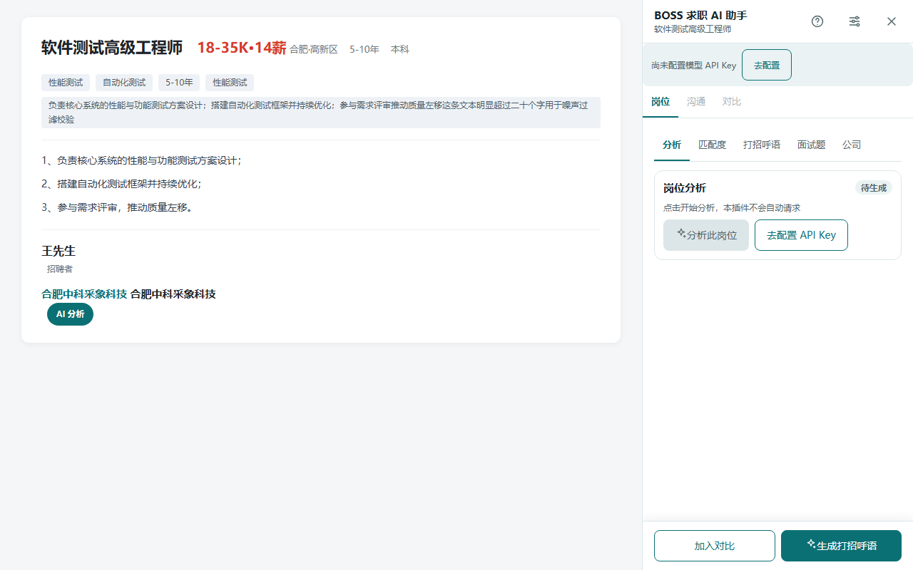
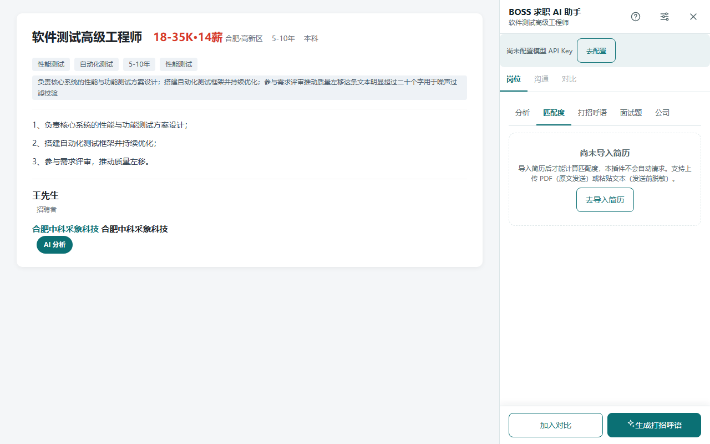
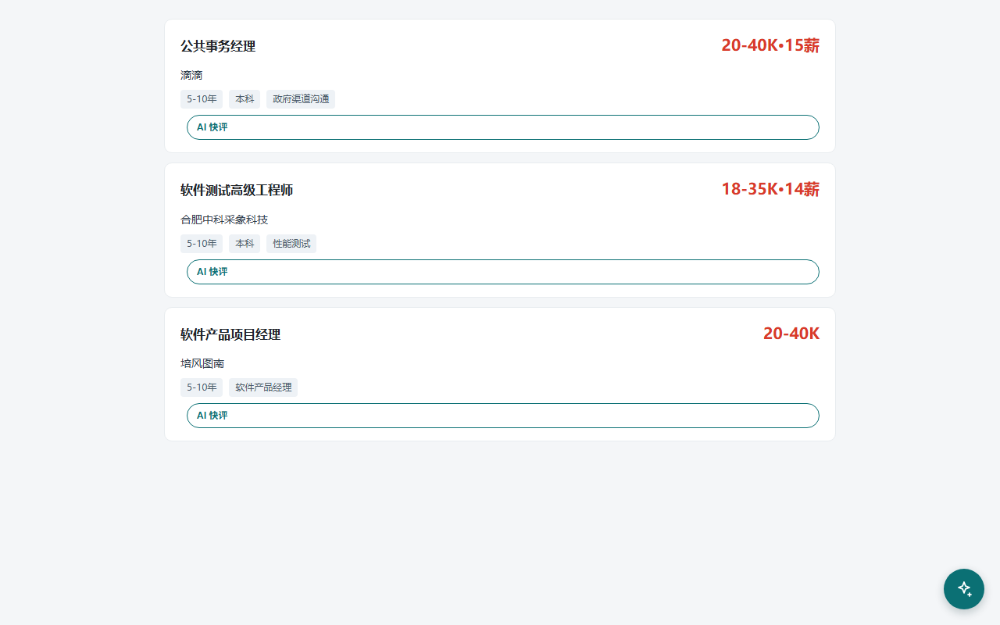
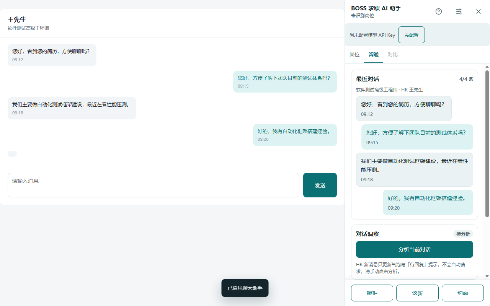
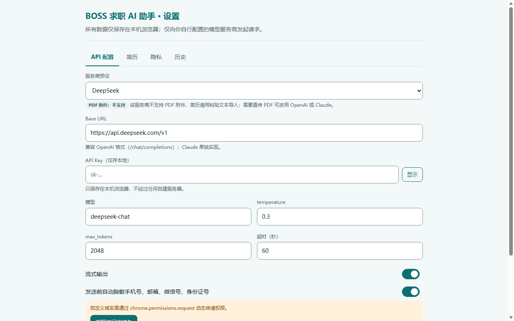

# BOSS 求职 AI 助手

在 BOSS直聘 页面内直接使用 AI 的 Edge 浏览器扩展（Manifest V3）。分析岗位、评估简历匹配度、生成沟通建议并识别风险信号。

## 功能特性

- **岗位分析**：一键解析当前 JD，输出岗位评分、亮点与风险点，可合并粘贴外部文本综合分析
- **简历匹配**：导入 PDF 简历，计算岗位匹配度评分
- **打招呼语生成**：结合简历自动生成打招呼话术
- **预测面试题**：基于 JD 预判可能的面试问题
- **沟通助手**：聊天记录快评、回复建议与风险信号识别
- **岗位对比**：多岗位横向对比薪资、匹配度与风险

## 功能截图

| 岗位分析 | 简历匹配度 |
|---|---|
|  |  |

| 列表页 AI 快评 | 沟通助手 |
|---|---|
|  |  |



*截图为扩展真实运行界面（1280×800），页面部分为演示数据。*

## 隐私与权限

- 数据仅存本地（`chrome.storage`），无自建后端，不上传任何用户数据
- 必需权限仅 `storage`，页面注入仅限 `www.zhipin.com`
- AI 请求只发往你自行配置的模型服务商（BYOK，Bring Your Own Key），自定义 API 域名通过动态授权申请
- OpenAI 与 Claude 原生支持 PDF 简历直传，其余服务商见配置页能力徽标

## 支持的模型服务商

OpenAI、Anthropic Claude、DeepSeek、通义千问、Kimi、智谱 GLM，以及任意 OpenAI 兼容的自定义接口。

## 从源码构建

```bash
git clone https://github.com/Menpengpeng/boss-ai-assistant.git
cd boss-ai-assistant
npm install
npm run build
```

构建产物输出至 `dist/`。在 Edge 打开 `edge://extensions`，开启「开发人员模式」，选择「加载解压缩的扩展」并指向 `dist/` 目录即可。

## 开发

```bash
npm test                # 运行单元测试
npm run check:encoding  # 编码规范检查
npm run e2e             # Edge 端到端验证
```

## 许可证

本项目基于 [GPL-3.0](./LICENSE) 许可证开源。

本项目为独立开发的求职辅助工具，与 BOSS直聘无关联。
